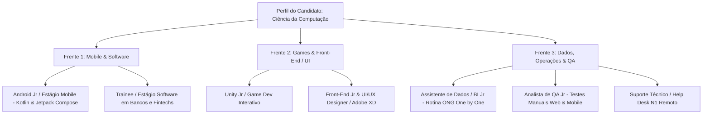

# 📄 Currículo Auto-Apply - Automação Estratégica de Vagas

Esta skill automatiza a prospecção, filtragem inteligente e envio de currículos para processos seletivos de maneira 100% autônoma e em segundo plano (**"por trás dos panos"**), operando com motor Playwright headless integrado ao **Antigravity**.

---

## 🎯 As 3 Frentes Estratégicas do Candidato

A automação está calibrada com base na formação acadêmica em **Ciência da Computação** e nas competências do Alex Sandro Arthur Silva Santos:



---

## 🔍 Alertas e Queries Recomendadas

A skill e os scripts suportam as queries booleanas recomendadas para o InfoJobs, LinkedIn e portais:

1. **Mobile & Software:**
   * `"Desenvolvedor Android" AND ("Kotlin" OR "Compose")`
   * `"Desenvolvedor Mobile" AND "PcD"`
   * `"Estágio Ciência da Computação" AND "Remoto"`
2. **Games & Front-End:**
   * `"Unity" AND ("Junior" OR "Estágio")`
   * `Desenvolvedor Unity Júnior`
   * `UI/UX Designer Júnior Remoto`
3. **Dados & QA / Suporte:**
   * `"QA" OR "Quality Assurance"`
   * `Assistente de QA Júnior`
   * `Analista de Suporte Técnico Remoto`

---

## 🌐 Portais Conectados e Suportados

* **InfoJobs (Sessão Ativa):** Automação com login autenticado, detecção de vagas e clique automatizado no botão `CANDIDATAR-ME`.
* **LinkedIn:** Varredura com suporte a Candidatura Simplificada (*Easy Apply*) e filtros de Senioridade (*Estágio / Júnior*).
* **Inklua & PCD Online:** Mapeamento de vagas com políticas afirmativas e opções de trabalho remoto.

---

## 🛠️ Como Utilizar

### 1. No Chat do Antigravity
* *"Busque vagas de Desenvolvedor Android Júnior no InfoJobs e liste as oportunidades."*
* *"Pesquise vagas de Unity ou Game Dev Júnior remotas e prepare a simulação."*
* *"Candidate meu currículo na vaga do InfoJobs [URL] em segundo plano."*
* *"Mostre o resumo das candidaturas já enviadas."*

### 2. Pelo Terminal ou Arquivos Batch
Na pasta [`scripts/`](./scripts/):
* **`run_apply.bat`:** Menu com seleção rápida das 3 frentes estratégicas (Mobile, Games/UI, Dados/QA).
* **Linha de comando:**
  ```powershell
  python auto_apply.py -q "Desenvolvedor Android" -p infojobs --submit
  ```
